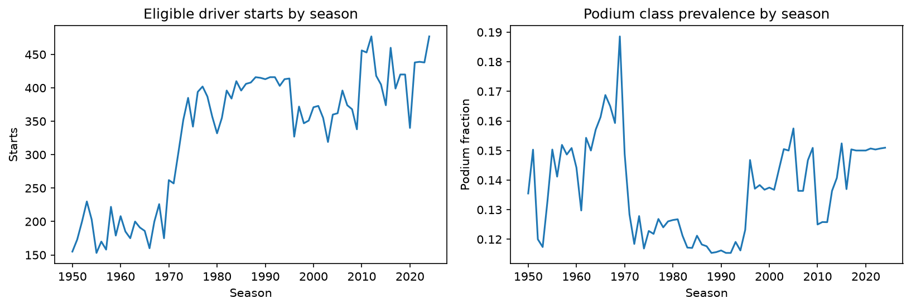
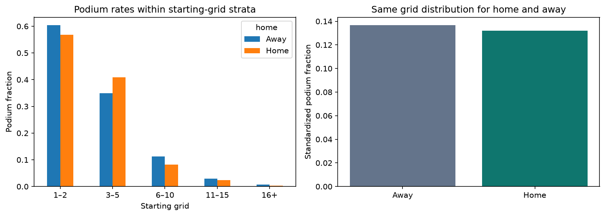
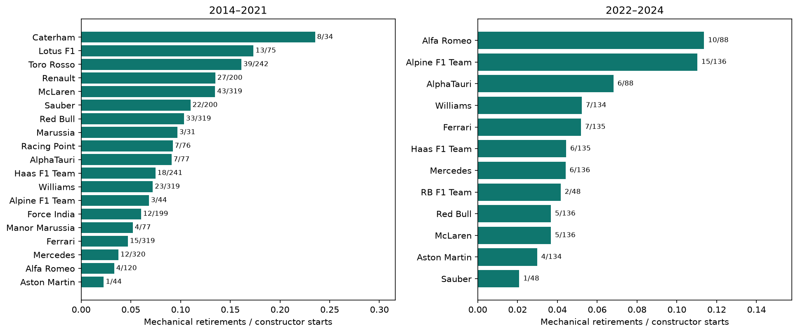
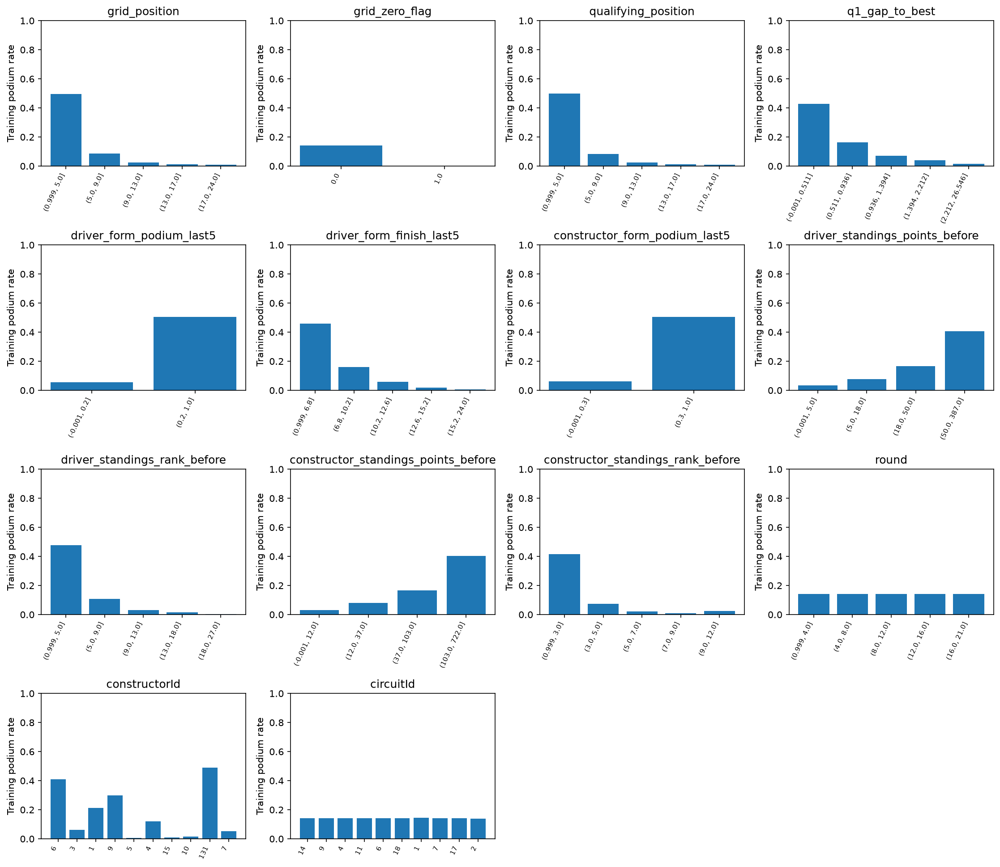
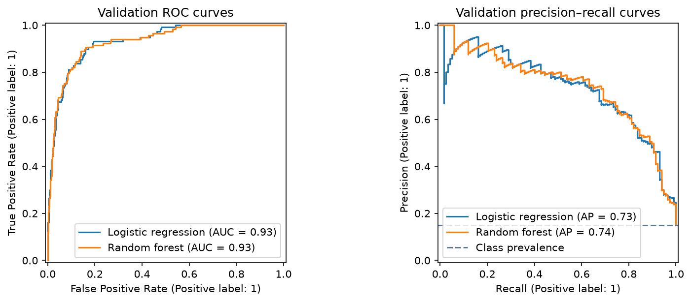
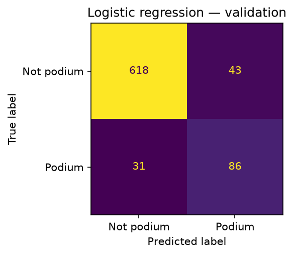

# ACL Milestone 1 — batch 1 report draft (work packages 1–10)

**Status:** reproducible first batch, not the final milestone submission. Shallow NN, ablation, preprocessing-order experiments, XAI, inference demonstrations, final test scores, team review, and final PDF remain for later batches.

## Objective and scope

Predict whether an eligible race starter finishes on the podium using information available after qualifying and before the main race. The binary label is positionOrder ≤ 3; exact finishing-position prediction is outside scope. Descriptive questions use historical outcomes, but those current-race outcomes never enter the predictor whitelist.

## Source and audit

Source: [the assignment-cited Kaggle/Ergast dataset](https://www.kaggle.com/datasets/rohanrao/formula-1-world-championship-1950-2020). The downloaded snapshot contains all 14 tables and results for all 24 races in 2024. Source_manifest.json records per-file SHA-256 and runtime versions. Every run checks that raw hashes are unchanged.

| table | rows | columns | primary_key | null_PK_rows | duplicate_PK_rows | missing_cells |
| --- | --- | --- | --- | --- | --- | --- |
| circuits | 77 | 9 | circuitId | 0 | 0 | 0 |
| constructors | 212 | 5 | constructorId | 0 | 0 | 0 |
| constructor_results | 12625 | 5 | constructorResultsId | 0 | 0 | 12608 |
| constructor_standings | 13391 | 7 | constructorStandingsId | 0 | 0 | 0 |
| drivers | 861 | 9 | driverId | 0 | 0 | 1559 |
| driver_standings | 34863 | 7 | driverStandingsId | 0 | 0 | 0 |
| races | 1125 | 18 | raceId | 0 | 0 | 11349 |
| results | 26759 | 18 | resultId | 0 | 0 | 122887 |
| qualifying | 10494 | 9 | qualifyId | 0 | 0 | 11668 |
| lap_times | 589081 | 6 | raceId, driverId, lap | 0 | 0 | 0 |
| pit_stops | 11371 | 7 | raceId, driverId, stop | 0 | 0 | 0 |
| sprint_results | 360 | 16 | resultId | 0 | 0 | 73 |
| seasons | 75 | 2 | year | 0 | 0 | 0 |
| status | 139 | 2 | statusId | 0 | 0 | 0 |

Implemented candidate-key checks found no null/duplicate primary keys; the documented foreign-key checks found no orphan values. Per-column schemas and missingness are in column_inventory.csv and each tested relationship is in foreign_key_checks.csv. These checks establish properties of this snapshot, not externally enforced database constraints.

## Cleaning, cohort and duplicate rule

Cleaning replaces literal backslash-N and blank tokens with actual missing values on working copies. Numeric columns, dates, and qualifying/lap/pit-stop durations receive semantic types; duration values are also represented in seconds. Conversion failures are counted and must be zero. Missing Q2/Q3 can be structural non-advancement; the baseline does not impute these as if every driver participated.

Raw results: 26,759 rows. Non-qualifier exclusions: 1,365; documented non-start exclusions: 257; uncertain zero-grid/zero-lap entries withheld: 38. Duplicate rows removed after eligibility filtering: 88. Final historical cohort: 25,011 unique driver–race rows.

Within duplicate driver–race groups, prefer a positive-grid source row over a zero-grid handover and break ties using the smallest resultId. Finishing position and target are never used to select the feature row. The target belongs to that retained source row; historical shared-drive outcomes may differ under another justified rule. All affected source rows and selections are retained in duplicate_resolution.csv. Historical starting-car identity is not always recoverable; do not interpret the rule as verified ground truth for every shared drive.

A zero grid is kept when there is evidence of race participation (positive laps), including pit-lane starters; zero-grid/zero-lap uncertain entries are separately withheld. Zero is not ranked ahead of pole. Status and laps are used only for retrospective cohort auditing/labels, never predictors. Results alone cannot independently establish every DNS or pit-lane start, especially positive-grid zero-lap engine/accident cases. This is conditional prediction for reconstructed starters, not a model of which entrants will start.

Before/after cleaning and cohort construction; unchanged missing-cell totals reflect representation changes, not unexplained imputation.

Qualifying coverage by season; the training portion supports beginning the modeling window in 2003.

Changing field sizes and podium prevalence make historical and modern eras non-exchangeable.

## Question 1 — front-row starts by circuit and the 2014 boundary

Join path: results → races → circuits, with qualifying joined on (raceId, driverId) to distinguish qualifying rank from starting grid. Grain: one retained eligible driver–race. Numerator: podium finishes among actual grid 1/2 starts; denominator: those front-row starts. Compare 1950–2013 against 2014–2024. Indianapolis 500 is excluded as an explicitly different competition format. Grid missing/zero cases are outside front-row denominators; missing qualifying rows do not remove known-grid starts.

The highest supported rates (at least 10 front-row starts for this display; the unfiltered table is also saved) are:

| era | circuit_name | starts | podiums | rate |
| --- | --- | --- | --- | --- |
| 1950–2013 | Circuit de Nevers Magny-Cours | 36 | 29 | 0.8056 |
| 1950–2013 | Istanbul Park | 14 | 11 | 0.7857 |
| 1950–2013 | Indianapolis Motor Speedway | 14 | 11 | 0.7857 |
| 2014–2024 | Suzuka Circuit | 18 | 16 | 0.8889 |
| 2014–2024 | Yas Marina Circuit | 22 | 19 | 0.8636 |
| 2014–2024 | Circuit de Monaco | 20 | 17 | 0.8500 |

Among circuits observed in both periods, 24 have different within-era ranks. Rankings also depend on changing circuit participation and small denominators; they are descriptive, not controlled causal comparisons. The full q1_circuit_changes.csv records common-circuit rate changes.

Front-row-to-podium conversion, with numerator/denominator labels; qualifying position is not substituted for grid.

## Question 2 — home-race podiums controlling starting grid

Join path: results → races → circuits, and results → drivers. Map nationality to country explicitly (British → UK; Monegasque → Monaco; USA/United States normalized). Ambiguous dual-nationality entries are withheld rather than guessed. Indianapolis is excluded. Only mapped starters with positive grid positions enter this comparison.

Control method: stratify grid into 1–2, 3–5, 6–10, 11–15, and 16+, then apply the same pooled grid-stratum weights to home and away rates on common support. The notebook saves each stratum’s counts and weights. This does not eliminate within-bin differences or driver/team/era confounding.

| group | raw_podium_rate | grid_standardized_rate |
| --- | --- | --- |
| Away | 0.1379 | 0.1366 |
| Home | 0.1166 | 0.1321 |

Grid-standardized home-minus-away difference: -0.45 percentage points. Rows excluded for unmapped nationality: 3; mapped rows lacking positive grid: 72. This association does not establish a causal home advantage.

Within-grid-stratum rates and standardized home/away rates.

## Question 3 — constructor mechanical retirements

Join path: results → status, results → races, and results → constructors. Periods are 2014–2021 and 2022–2024. Numerator: verified component/system failure statuses in the documented conservative mapping. Denominator: eligible constructor driver-starts, not race weekends or all entrants. Lapped finishers are finished, not retired. Accidents, driver causes, and regulatory decisions are excluded from mechanical failures.

| constructorId | constructor_name | period | starts | mechanical_retirements | ambiguous_statuses | mechanical_rate |
| --- | --- | --- | --- | --- | --- | --- |
| 207 | Caterham | 2014–2021 | 34 | 8 | 3 | 0.2353 |
| 208 | Lotus F1 | 2014–2021 | 75 | 13 | 5 | 0.1733 |
| 5 | Toro Rosso | 2014–2021 | 242 | 39 | 5 | 0.1612 |
| 4 | Renault | 2014–2021 | 200 | 27 | 6 | 0.1350 |
| 1 | McLaren | 2014–2021 | 319 | 43 | 8 | 0.1348 |
| 51 | Alfa Romeo | 2022–2024 | 88 | 10 | 1 | 0.1136 |
| 214 | Alpine F1 Team | 2022–2024 | 136 | 15 | 0 | 0.1103 |
| 213 | AlphaTauri | 2022–2024 | 88 | 6 | 1 | 0.0682 |
| 3 | Williams | 2022–2024 | 134 | 7 | 4 | 0.0522 |
| 6 | Ferrari | 2022–2024 | 135 | 7 | 3 | 0.0519 |

Each constructorId is analyzed separately; renames are not silently combined. Generic Retired, damage, tyre/puncture, wing and other ambiguous causes are not assumed mechanical: their counts are saved in q3_ambiguous_status_counts.csv. Reported mechanical rates may therefore undercount failures with vague cause labels. Denominator size and constructor lifetimes differ.

Mechanical retirements per constructor driver-start, with count labels.

## Features and chronological evaluation design

Model window: 2003–2024, chosen because training-only coverage is consistently near-complete from 2003, while 1996–2002 coverage is patchy. Training is 2003–2019; validation is 2020–2021; test is reserved at 2022–2024. Earlier rows are retained for historical questions and prior-race history. All rows from one race stay in the same split.

Driver form shifts each history before rolling over up to five earlier starts. Constructor form first aggregates each race then shifts before rolling, so the teammate’s current result cannot leak. Standings use the most recent strictly earlier main race within the same season, with source-event assertions and season-start handling. Earlier validation/test races may supply observed history for later races, corresponding to sequential pre-race deployment. Current-weekend sprint results are deliberately excluded; no claim is made that every sprint format shares the same cutoff.

| feature | group | source | training_missing_fraction | training_spearman_with_podium |
| --- | --- | --- | --- | --- |
| grid_position | grid | results.grid | 0.0028 | -0.4944 |
| grid_zero_flag | grid | results.grid | 0.0000 | -0.0215 |
| qualifying_position | qualifying | qualifying.position | 0.0031 | -0.4967 |
| q1_gap_to_best | qualifying | qualifying.q1 | 0.0181 | -0.3972 |
| driver_form_podium_last5 | form | earlier results | 0.0110 | 0.5268 |
| driver_form_finish_last5 | form | earlier results | 0.0110 | -0.4432 |
| constructor_form_podium_last5 | form | earlier results | 0.0051 | 0.5148 |
| driver_standings_points_before | standings | driver_standings + races | 0.0000 | 0.3706 |
| driver_standings_rank_before | standings | driver_standings + races | 0.0713 | -0.4778 |
| constructor_standings_points_before | standings | constructor_standings + races | 0.0000 | 0.3624 |
| constructor_standings_rank_before | standings | constructor_standings + races | 0.0568 | -0.4465 |
| round | context | races.round | 0.0000 | -0.0001 |
| constructorId | identity | results.constructorId | 0.0000 | — |
| circuitId | context | races.circuitId | 0.0000 | — |

Feature hypotheses: grid/qualifying represent starting opportunity and qualifying pace; driver and constructor form represent recent competitiveness; prior standings represent season strength; constructor and circuit identities represent team/circuit context; round represents championship progress. The training-only plots show associations and missingness; these motivate candidate inclusion but do not establish incremental predictive value. Batch 2 ablation will assess group contribution. IDs are one-hot categorical values, not continuous ranks. Model selection and preprocessing never fit on validation/test rows.

Training-only evidence for the candidate features; associations are not causal effects.

## Statistical-model comparison (work packages 9–10)

Baseline: logistic regression, a regularized linear model of log-odds; it is interpretable but cannot represent arbitrary interactions without engineered terms. Compare C = 0.1, 1, 10 on training/validation. Random forest averages 250 trees and can learn nonlinearities/interactions, but can overfit, struggle with distribution shifts/unseen categories, and yields less direct interpretation. Compare max_depth = 6 or 12 with min_samples_leaf = 3.

Both models receive the same rows, feature whitelist and encoded feature names. Each pipeline learns median imputation with missing indicators, scaling, and one-hot categories on training data only. Scaled values do not change the ordering used by tree splits. Unknown categories are ignored by the fitted encoder and remain a limitation.

Primary selection metric: average precision (AP), because podiums are the minority class and precision–recall ranking is informative. AP is reported separately from trapezoidal PR-AUC; they are not silently equated. Secondary metrics include F1 at the chosen validation threshold and ROC-AUC, with accuracy, precision and recall for context. Thresholds are selected from 0.05–0.95 using validation F1 only. Hyperparameters are ranked by validation AP. The brief names three metrics but elsewhere says five; all six plan metrics plus AP are reported.

| model | split | threshold | accuracy | precision | recall | F1 | ROC_AUC | PR_AUC | average_precision |
| --- | --- | --- | --- | --- | --- | --- | --- | --- | --- |
| Logistic regression | train | 0.3300 | 0.8942 | 0.5976 | 0.7757 | 0.6751 | 0.9324 | 0.6897 | 0.6903 |
| Logistic regression | validation | 0.3300 | 0.9049 | 0.6667 | 0.7350 | 0.6992 | 0.9311 | 0.7308 | 0.7333 |
| Random forest | train | 0.4900 | 0.9340 | 0.8089 | 0.6989 | 0.7499 | 0.9730 | 0.8664 | 0.8665 |
| Random forest | validation | 0.4900 | 0.9165 | 0.7407 | 0.6838 | 0.7111 | 0.9306 | 0.7380 | 0.7396 |

The provisional validation AP leader is Random forest (AP 0.7396). This is not the final three-model comparison and not evidence of unseen test performance. Training metrics can be optimistic; validation has also been used for choices.

Validation ROC and precision–recall curves; the prevalence line is the PR baseline.

Logistic-regression validation confusion matrix at its validation-selected threshold.

Random-forest validation confusion matrix at its validation-selected threshold.

## Remaining work and interpretation limits

No test scores or test predictions are computed in this batch. After NN, ablation, preprocessing experiments and all choices are frozen, evaluate every locked model once on the test split and report all metrics. Add XAI (global permutation importance/SHAP and local LIME/SHAP), inference demonstrations, and the complete PDF with every figure. Every team member must review and defend the whole pipeline. Confirm teammate access before marking setup complete.

Independent per-driver classifiers need not predict exactly three podiums per race; the brief requests binary classification, not constrained race rankings. Dataset grid values reflect recorded final grids rather than timestamped snapshots, so cutoff validity relies on their interpretation as the grid fixed before the start. Retrospective starter selection and historical shared drives remain material limitations. No numerical grade or perfect prediction accuracy is guaranteed.

## Sources

- MS1 Description (Project).pdf, pages 1–8 (local official course brief).

- Introduction for Formula 1 Beginners (Project).pdf, pages 1–7 (local course companion).

- [scikit-learn leakage and preprocessing guidance](https://scikit-learn.org/stable/common_pitfalls.html).

- [scikit-learn average precision definition](https://scikit-learn.org/stable/modules/generated/sklearn.metrics.average_precision_score.html).