# ACL Milestone 1 - Formula 1 Podium Prediction

**Status:** integrated implementation of work packages 1-20; team review, Kaggle verification and official submission remain pending.

## Objective and scope

Predict whether an eligible race starter finishes on the podium using information available after qualifying and before the main race. The binary label is positionOrder ≤ 3; exact finishing-position prediction is outside scope. Descriptive questions use historical outcomes, but those current-race outcomes never enter the predictor whitelist.

## Source and audit

Source: [the assignment-cited Kaggle/Ergast dataset](https://www.kaggle.com/datasets/rohanrao/formula-1-world-championship-1950-2020). The downloaded snapshot contains all 14 tables and results for all 24 races in 2024. Source_manifest.json records per-file SHA-256 and runtime versions. Every run checks that raw hashes are unchanged.

| table | rows | columns | primary_key | null_PK_rows | duplicate_PK_rows | missing_cells |
| --- | --- | --- | --- | --- | --- | --- |
| circuits | 77 | 9 | circuitId | 0 | 0 | 0 |
| constructors | 212 | 5 | constructorId | 0 | 0 | 0 |
| constructor_results | 12625 | 5 | constructorResultsId | 0 | 0 | 12608 |
| constructor_standings | 13391 | 7 | constructorStandingsId | 0 | 0 | 0 |
| drivers | 861 | 9 | driverId | 0 | 0 | 1559 |
| driver_standings | 34863 | 7 | driverStandingsId | 0 | 0 | 0 |
| races | 1125 | 18 | raceId | 0 | 0 | 11349 |
| results | 26759 | 18 | resultId | 0 | 0 | 122887 |
| qualifying | 10494 | 9 | qualifyId | 0 | 0 | 11668 |
| lap_times | 589081 | 6 | raceId, driverId, lap | 0 | 0 | 0 |
| pit_stops | 11371 | 7 | raceId, driverId, stop | 0 | 0 | 0 |
| sprint_results | 360 | 16 | resultId | 0 | 0 | 73 |
| seasons | 75 | 2 | year | 0 | 0 | 0 |
| status | 139 | 2 | statusId | 0 | 0 | 0 |

Implemented candidate-key checks found no null/duplicate primary keys; the documented foreign-key checks found no orphan values. Per-column schemas and missingness are in column_inventory.csv and each tested relationship is in foreign_key_checks.csv. These checks establish properties of this snapshot, not externally enforced database constraints.

## Cleaning, cohort and duplicate rule

Cleaning replaces literal backslash-N and blank tokens with actual missing values on working copies. Numeric columns, dates, and qualifying/lap/pit-stop durations receive semantic types; duration values are also represented in seconds. Conversion failures are counted and must be zero. Missing Q2/Q3 can be structural non-advancement; the baseline does not impute these as if every driver participated.

Raw results: 26,759 rows. Non-qualifier exclusions: 1,365; documented non-start exclusions: 257; uncertain zero-grid/zero-lap entries withheld: 38. Duplicate rows removed after eligibility filtering: 88. Final historical cohort: 25,011 unique driver–race rows.

Within duplicate driver–race groups, prefer a positive-grid source row over a zero-grid handover and break ties using the smallest resultId. Finishing position and target are never used to select the feature row. The target belongs to that retained source row; historical shared-drive outcomes may differ under another justified rule. All affected source rows and selections are retained in duplicate_resolution.csv. Historical starting-car identity is not always recoverable; do not interpret the rule as verified ground truth for every shared drive.

A zero grid is kept when there is evidence of race participation (positive laps), including pit-lane starters; zero-grid/zero-lap uncertain entries are separately withheld. Zero is not ranked ahead of pole. Status and laps are used only for retrospective cohort auditing/labels, never predictors. Results alone cannot independently establish every DNS or pit-lane start, especially positive-grid zero-lap engine/accident cases. This is conditional prediction for reconstructed starters, not a model of which entrants will start.

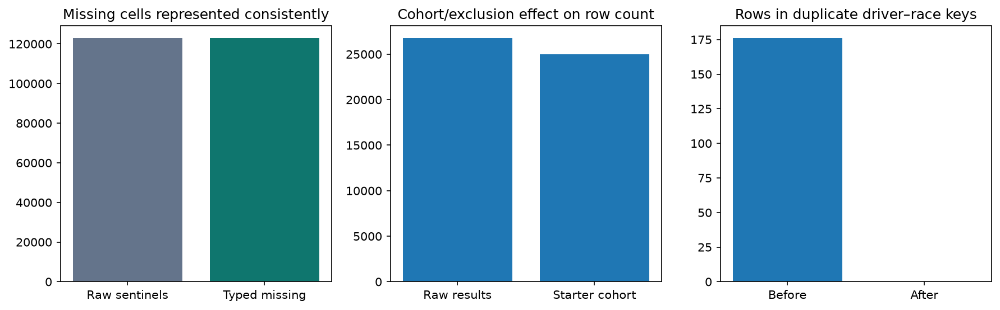

Before/after cleaning and cohort construction; unchanged missing-cell totals reflect representation changes, not unexplained imputation.

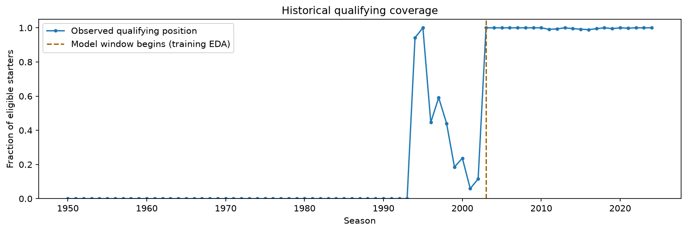

Qualifying coverage by season; the training portion supports beginning the modeling window in 2003.

Changing field sizes and podium prevalence make historical and modern eras non-exchangeable.

## Question 1 — front-row starts by circuit and the 2014 boundary

Join path: results → races → circuits, with qualifying joined on (raceId, driverId) to distinguish qualifying rank from starting grid. Grain: one retained eligible driver–race. Numerator: podium finishes among actual grid 1/2 starts; denominator: those front-row starts. Compare 1950–2013 against 2014–2024. Indianapolis 500 is excluded as an explicitly different competition format. Grid missing/zero cases are outside front-row denominators; missing qualifying rows do not remove known-grid starts.

The highest supported rates (at least 10 front-row starts for this display; the unfiltered table is also saved) are:

| era | circuit_name | starts | podiums | rate |
| --- | --- | --- | --- | --- |
| 1950–2013 | Circuit de Nevers Magny-Cours | 36 | 29 | 0.8056 |
| 1950–2013 | Istanbul Park | 14 | 11 | 0.7857 |
| 1950–2013 | Indianapolis Motor Speedway | 14 | 11 | 0.7857 |
| 2014–2024 | Suzuka Circuit | 18 | 16 | 0.8889 |
| 2014–2024 | Yas Marina Circuit | 22 | 19 | 0.8636 |
| 2014–2024 | Circuit de Monaco | 20 | 17 | 0.8500 |

Among circuits observed in both periods, 24 have different within-era ranks. Rankings also depend on changing circuit participation and small denominators; they are descriptive, not controlled causal comparisons. The full q1_circuit_changes.csv records common-circuit rate changes.

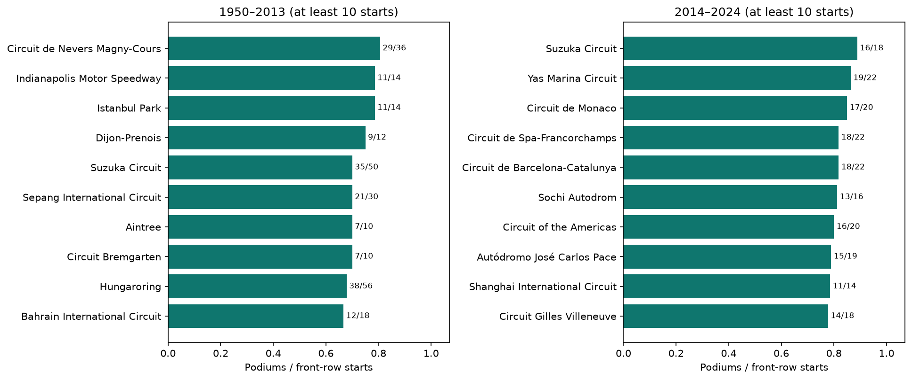

Front-row-to-podium conversion, with numerator/denominator labels; qualifying position is not substituted for grid.

## Question 2 — home-race podiums controlling starting grid

Join path: results → races → circuits, and results → drivers. Map nationality to country explicitly (British → UK; Monegasque → Monaco; USA/United States normalized). Ambiguous dual-nationality entries are withheld rather than guessed. Indianapolis is excluded. Only mapped starters with positive grid positions enter this comparison.

Control method: stratify grid into 1–2, 3–5, 6–10, 11–15, and 16+, then apply the same pooled grid-stratum weights to home and away rates on common support. The notebook saves each stratum’s counts and weights. This does not eliminate within-bin differences or driver/team/era confounding.

| group | raw_podium_rate | grid_standardized_rate |
| --- | --- | --- |
| Away | 0.1379 | 0.1366 |
| Home | 0.1166 | 0.1321 |

Grid-standardized home-minus-away difference: -0.45 percentage points. Rows excluded for unmapped nationality: 3; mapped rows lacking positive grid: 72. This association does not establish a causal home advantage.

Within-grid-stratum rates and standardized home/away rates.

## Question 3 — constructor mechanical retirements

Join path: results → status, results → races, and results → constructors. Periods are 2014–2021 and 2022–2024. Numerator: verified component/system failure statuses in the documented conservative mapping. Denominator: eligible constructor driver-starts, not race weekends or all entrants. Lapped finishers are finished, not retired. Accidents, driver causes, and regulatory decisions are excluded from mechanical failures.

| constructorId | constructor_name | period | starts | mechanical_retirements | ambiguous_statuses | mechanical_rate |
| --- | --- | --- | --- | --- | --- | --- |
| 207 | Caterham | 2014–2021 | 34 | 8 | 3 | 0.2353 |
| 208 | Lotus F1 | 2014–2021 | 75 | 13 | 5 | 0.1733 |
| 5 | Toro Rosso | 2014–2021 | 242 | 39 | 5 | 0.1612 |
| 4 | Renault | 2014–2021 | 200 | 27 | 6 | 0.1350 |
| 1 | McLaren | 2014–2021 | 319 | 43 | 8 | 0.1348 |
| 51 | Alfa Romeo | 2022–2024 | 88 | 10 | 1 | 0.1136 |
| 214 | Alpine F1 Team | 2022–2024 | 136 | 15 | 0 | 0.1103 |
| 213 | AlphaTauri | 2022–2024 | 88 | 6 | 1 | 0.0682 |
| 3 | Williams | 2022–2024 | 134 | 7 | 4 | 0.0522 |
| 6 | Ferrari | 2022–2024 | 135 | 7 | 3 | 0.0519 |

Each constructorId is analyzed separately; renames are not silently combined. Generic Retired, damage, tyre/puncture, wing and other ambiguous causes are not assumed mechanical: their counts are saved in q3_ambiguous_status_counts.csv. Reported mechanical rates may therefore undercount failures with vague cause labels. Denominator size and constructor lifetimes differ.

Mechanical retirements per constructor driver-start, with count labels.

## Features and chronological evaluation design

Model window: 2003–2024, chosen because training-only coverage is consistently near-complete from 2003, while 1996–2002 coverage is patchy. Training is 2003–2019; validation is 2020–2021; test is held out at 2022–2024 until the choice-freeze step. Earlier rows are retained for historical questions and prior-race history. All rows from one race stay in the same split.

Driver form shifts each history before rolling over up to five earlier starts. Constructor form first aggregates each race then shifts before rolling, so the teammate’s current result cannot leak. Standings use the most recent strictly earlier main race within the same season, with source-event assertions and season-start handling. Earlier validation/test races may supply observed history for later races, corresponding to sequential pre-race deployment. Current-weekend sprint results are deliberately excluded; no claim is made that every sprint format shares the same cutoff.

| feature | group | source | training_missing_fraction | training_spearman_with_podium |
| --- | --- | --- | --- | --- |
| grid_position | grid | results.grid | 0.0028 | -0.4944 |
| grid_zero_flag | grid | results.grid | 0.0000 | -0.0215 |
| qualifying_position | qualifying | qualifying.position | 0.0031 | -0.4967 |
| q1_gap_to_best | qualifying | qualifying.q1 | 0.0181 | -0.3972 |
| driver_form_podium_last5 | form | earlier results | 0.0110 | 0.5268 |
| driver_form_finish_last5 | form | earlier results | 0.0110 | -0.4432 |
| constructor_form_podium_last5 | form | earlier results | 0.0051 | 0.5148 |
| driver_standings_points_before | standings | driver_standings + races | 0.0000 | 0.3706 |
| driver_standings_rank_before | standings | driver_standings + races | 0.0713 | -0.4778 |
| constructor_standings_points_before | standings | constructor_standings + races | 0.0000 | 0.3624 |
| constructor_standings_rank_before | standings | constructor_standings + races | 0.0568 | -0.4465 |
| round | context | races.round | 0.0000 | -0.0001 |
| constructorId | identity | results.constructorId | 0.0000 | — |
| circuitId | context | races.circuitId | 0.0000 | — |

Feature hypotheses: grid/qualifying represent starting opportunity and qualifying pace; driver and constructor form represent recent competitiveness; prior standings represent season strength; constructor and circuit identities represent team/circuit context; round represents championship progress. The training-only plots show associations and missingness; these motivate candidate inclusion but do not establish incremental predictive value. The ablation section below measures group contribution. IDs are one-hot categorical values, not continuous ranks. Model selection and preprocessing never fit on validation/test rows.

Training-only evidence for the candidate features; associations are not causal effects.

## Team and contribution verification

Team listed in the shared plan: Amr Hazem Mohamed Mohamed Hassan Elkotit; Mark Bassem Mourad Samoel Emira; Loay Mohamed Sabry Farag Ismail; Karim Ahmed Mahmoud Abdelmageed. Existing work-package ownership remains unchanged. Implementation assistance does not prove individual contributions or understanding; each member must review and defend the complete notebook. Contribution sign-off is pending.

## Additional detail for Question 1 - unfiltered versus supported leaders

The full ranking answers the question for every observed circuit; the supported display excludes fewer than 10 front-row starts to avoid presenting a tiny denominator as a stable best circuit. The unfiltered leaders below may be based on very few starts:

| era | circuit_name | starts | podiums | rate |
| --- | --- | --- | --- | --- |
| 1950–2013 | Circuit of the Americas | 4 | 4 | 1.0000 |
| 1950–2013 | Donington Park | 2 | 2 | 1.0000 |
| 1950–2013 | Ain Diab | 2 | 2 | 1.0000 |
| 2014–2024 | Miami International Autodrome | 6 | 6 | 1.0000 |
| 2014–2024 | Autódromo Internacional do Algarve | 4 | 4 | 1.0000 |
| 2014–2024 | Las Vegas Strip Street Circuit | 4 | 4 | 1.0000 |

Supported leaders (at least 10 starts) are:

| era | circuit_name | starts | podiums | rate |
| --- | --- | --- | --- | --- |
| 1950–2013 | Circuit de Nevers Magny-Cours | 36 | 29 | 0.8056 |
| 1950–2013 | Istanbul Park | 14 | 11 | 0.7857 |
| 1950–2013 | Indianapolis Motor Speedway | 14 | 11 | 0.7857 |
| 2014–2024 | Suzuka Circuit | 18 | 16 | 0.8889 |
| 2014–2024 | Yas Marina Circuit | 22 | 19 | 0.8636 |
| 2014–2024 | Circuit de Monaco | 20 | 17 | 0.8500 |

The Indianapolis 500 event is excluded, not every race at Indianapolis Motor Speedway: the later United States Grand Prix on its road course remains eligible.

## Three-model training, selection and comparison

Logistic regression (LR) is the statistical baseline: regularized linear log-odds, transparent but limited for nonlinear interactions. The random forest (RF) averages 250 trees; it represents interactions but can overfit and is sensitive to distribution shifts. The shallow feed-forward neural network (NN) uses ReLU hidden units and an Adam optimizer with L2 regularization alpha = 0.01. It can represent nonlinearities but is sensitive to scaling, optimization choices, random initialization, and overfitting.

LR candidates use C = 0.1, 1, 10; RF candidates use max_depth = 6 or 12 with min_samples_leaf = 3. NN trials use hidden layers (32,) and (32, 16), each trained for up to 150 epochs. Gradients use 2003-2019 only. Checkpoints at epoch 1 and every 5 epochs are selected by explicit 2020-2021 validation AP, with the earliest checkpoint retained on ties. No internal random validation split is used. Validation F1 selects thresholds from 0.05 to 0.95; the default 0.5 is not assumed optimal.

Selected NN configuration: hidden layers [32, 16], checkpoint epoch 20. The complete training and validation histories are preserved in nn_training_history.csv. The two architectural trials are:

| parameters | validation_AP |
| --- | --- |
| {"hidden_layer_sizes": [32], "alpha": 0.01, "solver": "adam", "learning_rate_init": 0.001, "selected_epoch": 25, "max_checked_epoch": 150, "checkpoint_selection": "highest validation AP; earliest checkpoint on ties"} | 0.7372 |
| {"hidden_layer_sizes": [32, 16], "alpha": 0.01, "solver": "adam", "learning_rate_init": 0.001, "selected_epoch": 20, "max_checked_epoch": 150, "checkpoint_selection": "highest validation AP; earliest checkpoint on ties"} | 0.7396 |

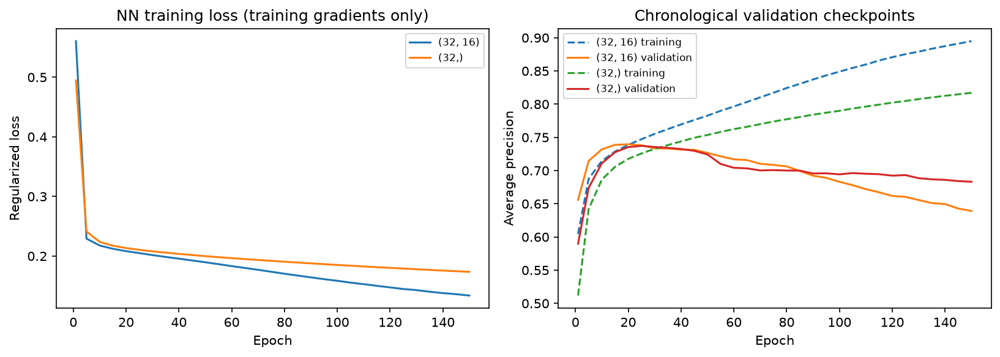

Training loss and chronological validation AP show whether additional training improves generalization rather than only fit to training data.

All three models use the same driver-race rows, the same 14 canonical input features, and matching encoded feature names. Each main pipeline fits median imputation with missing indicators, numeric scaling and one-hot categorical encoding on training only. Unknown categories map to all-zero one-hot values and remain a documented limitation. Class balancing/resampling is not introduced; the task is assessed with minority-class-aware precision-recall metrics.

Metric definitions: accuracy is the fraction of correct binary decisions; precision is the fraction of predicted podiums that are podiums; recall is the fraction of actual podiums found; F1 is their harmonic mean at the locked threshold. ROC-AUC assesses ranking across false/true-positive tradeoffs. PR-AUC is trapezoidal area under precision versus recall. Average precision (AP) is a separate step-weighted precision-recall summary. AP drives validation selection; PR-AUC, F1 and ROC-AUC supply complementary evidence. Accuracy alone can conceal the podium minority. The brief lists three named metrics but also refers to five; all six plan metrics plus AP are provided, and the wording remains for course verification.

### Decisions fixed before test evaluation

The selected inference model is Random forest, chosen using validation AP only. All models keep the full predeclared feature set and baseline preprocessing. Ablation and order experiments below are diagnostic, not a basis for test-driven changes. Fitted-pipeline hashes, row hashes, hyperparameters, NN checkpoint and thresholds were recorded before any test predictions. Choice manifest SHA-256: f650c67a131721a39f46243d89dc94b2950b3d970971eb7f2a4ce79c8f4a37d3.

The 2022-2024 results below were computed only after that freeze. They cannot be used to select a different winner, threshold, feature set or preprocessing order. Re-running an identical frozen pipeline checks reproducibility; it does not make the already revealed test set new evidence for further tuning.

| model | threshold | settings |
| --- | --- | --- |
| LR | 0.3300 | {"C": 1.0} |
| RF | 0.4900 | {"max_depth": 12, "min_samples_leaf": 3, "n_estimators": 250} |
| NN | 0.4900 | {"hidden_layer_sizes": [32, 16], "alpha": 0.01, "solver": "adam", "learning_rate_init": 0.001, "selected_epoch": 20, "max_checked_epoch": 150, "checkpoint_selection": "highest validation AP; earliest checkpoint on ties"} |

### Training, validation and held-out test metrics

LR = logistic regression; RF = random forest; NN = shallow neural network. Every metric is computed on the same split rows for all models. Training figures are descriptive and optimistically biased; validation was used for selection. Test figures are the locked-model generalization check.

| model | split | accuracy | precision | recall | F1 | ROC_AUC | PR_AUC | AP |
| --- | --- | --- | --- | --- | --- | --- | --- | --- |
| LR | train | 0.8942 | 0.5976 | 0.7757 | 0.6751 | 0.9324 | 0.6897 | 0.6903 |
| LR | validation | 0.9049 | 0.6667 | 0.7350 | 0.6992 | 0.9311 | 0.7308 | 0.7333 |
| LR | test | 0.8863 | 0.5947 | 0.7696 | 0.6709 | 0.9368 | 0.7084 | 0.7095 |
| RF | train | 0.9340 | 0.8089 | 0.6989 | 0.7499 | 0.9730 | 0.8664 | 0.8665 |
| RF | validation | 0.9165 | 0.7407 | 0.6838 | 0.7111 | 0.9306 | 0.7380 | 0.7396 |
| RF | test | 0.9010 | 0.6944 | 0.6127 | 0.6510 | 0.9396 | 0.7164 | 0.7175 |
| NN | train | 0.9093 | 0.6852 | 0.6646 | 0.6747 | 0.9431 | 0.7384 | 0.7386 |
| NN | validation | 0.9139 | 0.7232 | 0.6923 | 0.7074 | 0.9260 | 0.7383 | 0.7396 |
| NN | test | 0.8929 | 0.6468 | 0.6373 | 0.6420 | 0.9314 | 0.6841 | 0.6853 |

The validation-selected Random forest has test F1 0.6510, ROC-AUC 0.9396, PR-AUC 0.7164, and AP 0.7175. This reports performance without claiming perfect accuracy or choosing a new model after observing test results.

RF and NN validation AP are nearly tied (0.739633 versus 0.739587); this small observed difference does not establish a statistically reliable superiority. RF has substantially higher training AP than validation AP, consistent with overfitting. On the held-out test, LR has higher F1/recall at its locked threshold while RF has higher AP/ROC-AUC; the choice of ranking metric versus thresholded decisions therefore changes the apparent ordering. These are descriptive comparisons, not permission to select a new winner using test results.

Statistical-model validation ROC and precision-recall curves from the initial batch.

LR validation decisions at its validation-selected threshold.

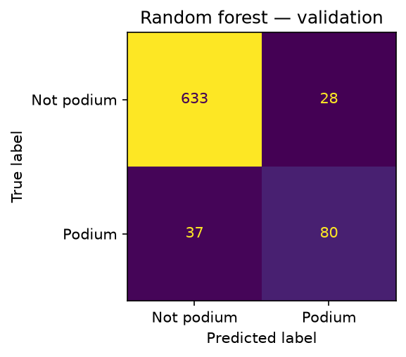

RF validation decisions at its validation-selected threshold.

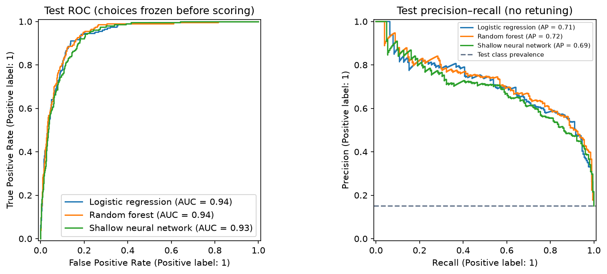

Locked three-model test ROC and precision-recall curves. The test prevalence line contextualizes PR performance.

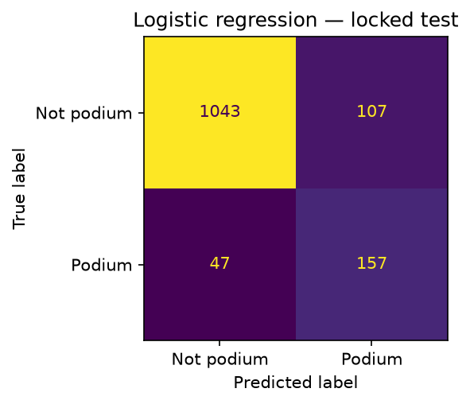

Logistic regression test confusion matrix at the locked validation-selected threshold.

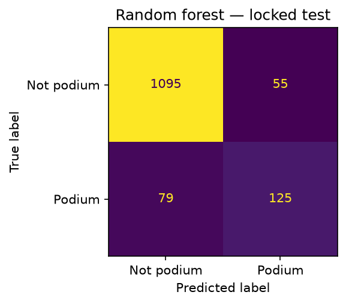

Random forest test confusion matrix at the locked validation-selected threshold.

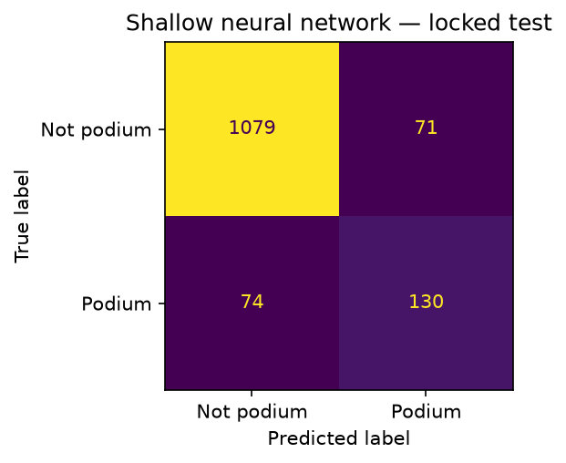

Shallow neural network test confusion matrix at the locked validation-selected threshold.

## Controlled experiments

### Feature-group ablation

The probe model is RF with its validation-selected settings and threshold fixed. Retrain once after dropping each of grid, qualifying, form, standings, context, and identity, using identical training/validation rows. Missing-indicator and one-hot columns are regenerated from each reduced training feature set. This measures group reliance in this model under correlation, not a causal contribution or the value of an isolated individual feature.

| removed_group | average_precision | F1 | AP_drop_from_full |
| --- | --- | --- | --- |
| none | 0.7396 | 0.7111 | 0.0000 |
| context | 0.7428 | 0.6964 | -0.0031 |
| form | 0.7268 | 0.6937 | 0.0128 |
| grid | 0.7029 | 0.7027 | 0.0367 |
| identity | 0.7261 | 0.6906 | 0.0136 |
| qualifying | 0.7298 | 0.6759 | 0.0098 |
| standings | 0.7197 | 0.7000 | 0.0199 |

Full-model validation AP is 0.7396. The largest AP reduction follows removing grid (0.0367). Groups whose removal improved AP: context. Negative drops are retained rather than hidden.

Correlated feature groups can substitute for one another. A small ablation drop does not establish irrelevance; apparent improvement may reflect variance or overfitting. The main comparison keeps the full feature set fixed for this milestone rather than making additional validation-guided revisions after revealing test scores.

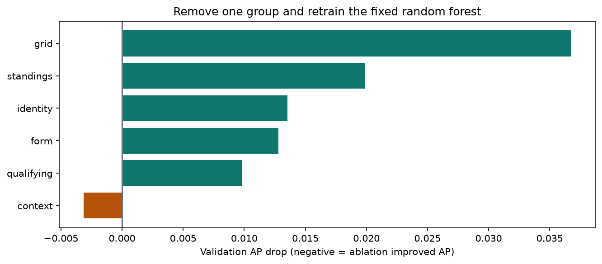

AP decrease from dropping each group; negative values mean the reduced model improved validation AP.

### Preprocessing-order experiment 1

Compare median-impute then standardize against standardize observed values (NaNs ignored during fitting) then median-impute. Both use the same numeric/categorical inputs, fixed LR C and threshold, identical rows, and no numeric missing-indicator expansion for equal experimental dimension. The main three-model pipelines retain their indicators; these experimental scores are not silently substituted into that main comparison.

| order | average_precision | F1 | ROC_AUC | PR_AUC |
| --- | --- | --- | --- | --- |
| impute_then_scale | 0.7240 | 0.6883 | 0.9264 | 0.7216 |
| scale_then_impute | 0.7247 | 0.6883 | 0.9265 | 0.7223 |

Observed validation AP changes from 0.724031 to 0.724731 when scaling first. F1 is unchanged at 0.688259: the small ranking change does not alter the locked-threshold decisions in this run. This is not evidence of a reliable improvement across future seasons.

Imputing before scaling changes the fitted variance because imputed observations participate in scale statistics. Scaling first estimates moments from observed values; later median imputation does not retroactively change those moments. If a feature has no missing values, the two orders may be equivalent for that feature.

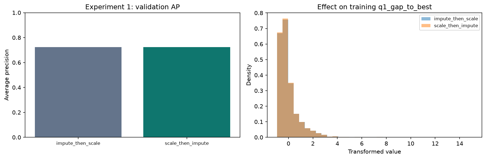

Experiment 1 validation AP and training distribution of transformed Q1 gap.

### Preprocessing-order experiment 2

After training-only median imputation, compare training 1st/99th-percentile clipping then scaling against scaling then clipping with bounds learned in the transformed training space. Same rows, LR settings, categories and threshold are held fixed. Clipping changes extremes; fitting scale before versus after clipping changes centering and variance. No quantile bounds are learned from validation/test.

| order | average_precision | F1 | ROC_AUC | PR_AUC |
| --- | --- | --- | --- | --- |
| impute_clip_scale | 0.7149 | 0.7020 | 0.9250 | 0.7116 |
| impute_scale_clip | 0.7155 | 0.7020 | 0.9250 | 0.7123 |

Observed validation AP changes from 0.714862 to 0.715525 when scaling before clipping. Both orders have F1 0.702041. The range audit shows the clipping orders substantially reduce extreme transformed Q1 gaps relative to the unclipped experiment, while their modest AP difference does not justify a new post-test model choice.

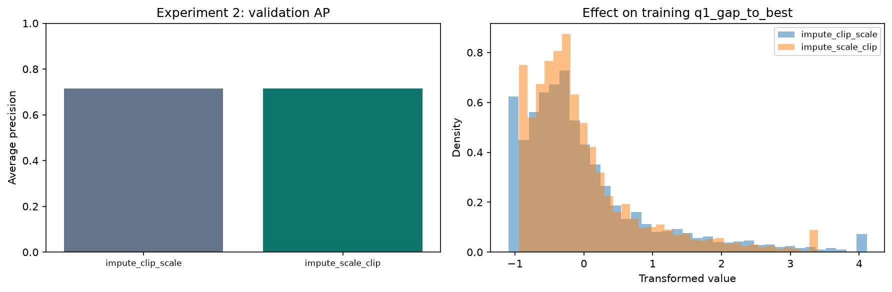

Experiment 2 validation AP and transformed training Q1-gap distributions; detailed range/moment effects are saved per feature.

### Effects on distributions, ranges and values

The numeric transformation audit records each training feature’s transformed mean, standard deviation, minimum and maximum for every order. The following example illustrates the effect; the complete table is delivered alongside the report.

| experiment | order | feature | mean | std | min | max |
| --- | --- | --- | --- | --- | --- | --- |
| 1 | impute_then_scale | q1_gap_to_best | -0.0000 | 1.0000 | -0.9412 | 15.0330 |
| 1 | scale_then_impute | q1_gap_to_best | -0.0046 | 0.9915 | -0.9378 | 14.9004 |
| 2 | impute_clip_scale | q1_gap_to_best | -0.0000 | 1.0000 | -1.0985 | 4.1117 |
| 2 | impute_scale_clip | q1_gap_to_best | -0.0254 | 0.8338 | -0.9412 | 3.4029 |

## Model explainability

The explained model is the validation-selected Random forest. Permutation importance shuffles each canonical input over validation data and measures AP drop, with five seeded repeats. Correlated inputs may share importance; shuffling can produce implausible combinations. The top permutation feature in this run is grid_position.

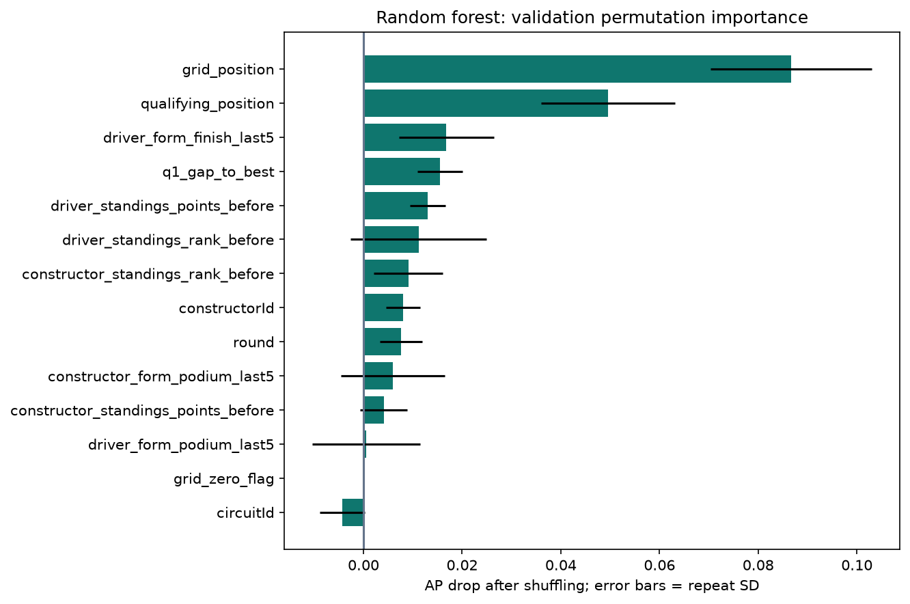

Global model reliance measured as validation AP loss after feature shuffling; bars may be negative and error bars show repeat SD, not confidence intervals.

Global SHAP method: Permutation SHAP, two permutation cycles per row; 32 training background rows; fallback after TreeSHAP failed the external probability-additivity check. Forty-eight validation records are explained using a training-only background. Encoded/OHE and missing-indicator contributions are summed back to original input features; mean absolute contributions summarize that sample. The leading feature is grid_position. Background/sample choices and dependent features affect these attributions.

The initial TreeSHAP decomposition failed the external probability-additivity check (maximum error 0.003532). The reported explanations therefore use permutation SHAP of the actual fitted prediction callable; the tolerance was not relaxed. This affects the explanation method, not the fitted classifier or its predictions.

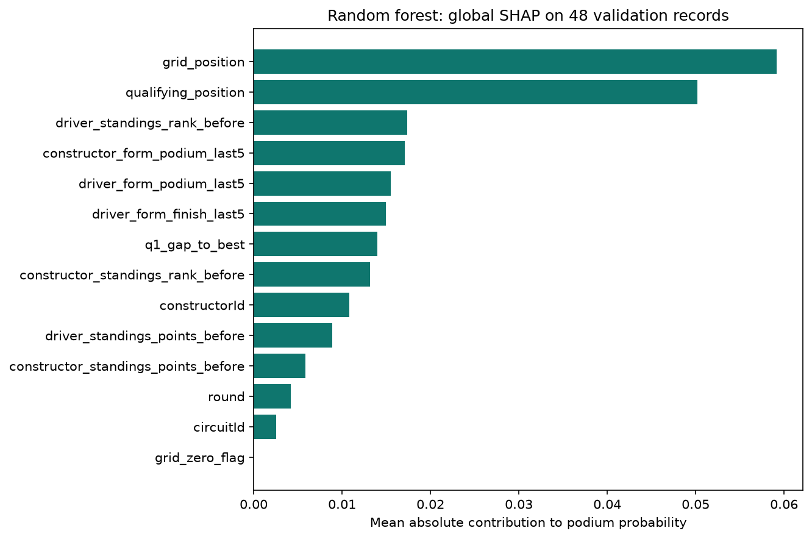

Global SHAP: mean absolute probability contribution on the stated validation sample, not a population-wide causal effect.

For one complete validation record, predicted podium probability is 0.7734, compared with SHAP baseline 0.1184. Largest positive contributions: grid_position (+0.1976), qualifying_position (+0.1569), constructor_form_podium_last5 (+0.0537). Most negative contributions: driver_standings_points_before (-0.0093), constructor_standings_points_before (-0.0006), grid_zero_flag (+0.0000). Maximum additivity error across the explained records is 7.77e-16.

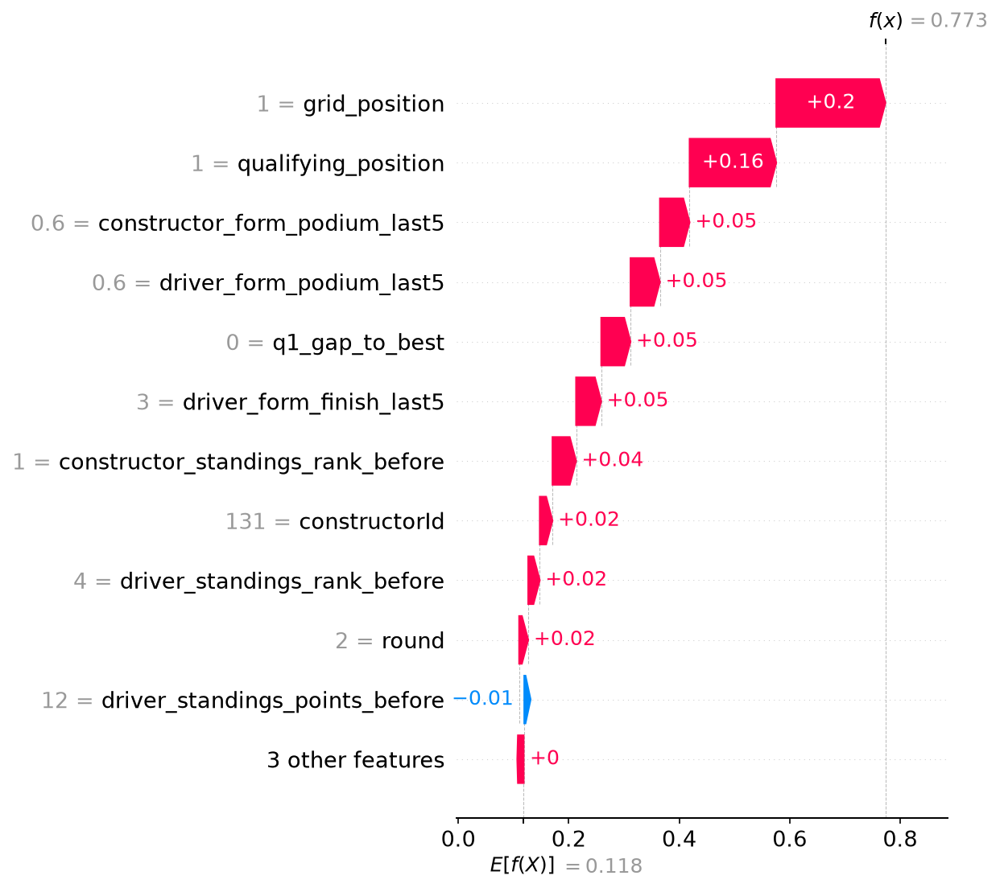

Local SHAP probability decomposition for the stated record; contributions plus baseline reconstruct the model probability.

A local LIME explanation is also supplied to cover the final checklist’s LIME wording. It uses training data, explicit categorical decoding, and 3,000 perturbed neighbors. Surrogate local R-squared is 0.6806; surrogate probability is 0.4793. R-squared describes the surrogate’s neighborhood fit, not the classifier’s prediction accuracy. A low value limits confidence in the local approximation. Correlated/engineered variables can still form unrealistic perturbed combinations.

The surrogate differs from the classifier probability at this record by 0.2941. That material approximation error limits the strength of the local LIME interpretation; its weights must not be treated as an exact probability decomposition.

| condition | weight |
| --- | --- |
| grid_position <= 6.00 | 0.0997 |
| qualifying_position <= 6.00 | 0.0976 |
| driver_form_podium_last5 > 0.20 | 0.0573 |
| driver_form_finish_last5 <= 7.80 | 0.0517 |
| driver_standings_rank_before <= 6.00 | 0.0425 |
| constructor_form_podium_last5 > 0.20 | 0.0410 |
| constructor_standings_rank_before <= 3.00 | 0.0347 |
| q1_gap_to_best <= 0.63 | 0.0265 |
| 9.00 < driver_standings_points_before <= 39.00 | -0.0096 |
| circuitId=70 | 0.0094 |

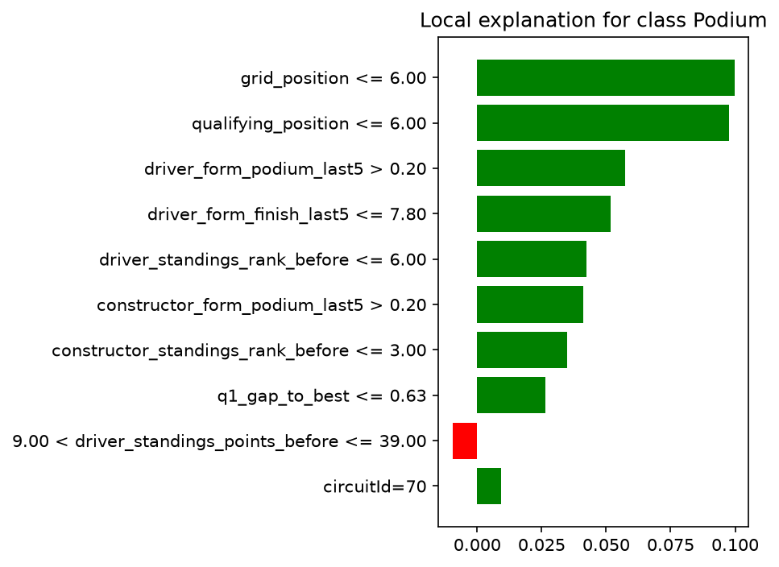

LIME weights describe a local surrogate; they are neither causal effects nor an exact SHAP-style probability decomposition.

All explanations describe how the model relies on the supplied data representation. They do not establish that changing a feature causes a podium. SHAP and LIME may differ because they use different neighborhoods, backgrounds and approximation objectives.

## Inference function and missing-data handling

podium_inference accepts a non-empty dictionary of the 14 engineered pre-race features. The caller must construct historical form/standings using only information before the cutoff. Missing numeric fields use the fitted training imputer; missing/unseen categorical identities use the encoder’s unknown-category behavior. Unknown or post-race keys are rejected. The function calls predict_proba without fitting, returns the locked threshold and binary prediction, and reports missing fields. Model hashes are asserted unchanged before/after the demonstrations.

Complete and partially missing examples are evaluated for every model on the same validation record; the partial example omits Q1 gap, qualifying position and prior driver rank. Results are:

| record_kind | model | podium_probability | threshold | predicted_podium |
| --- | --- | --- | --- | --- |
| complete | LR | 0.7348 | 0.3300 | 1 |
| partially_missing | LR | 0.1169 | 0.3300 | 0 |
| complete | RF | 0.7734 | 0.4900 | 1 |
| partially_missing | RF | 0.4825 | 0.4900 | 0 |
| complete | NN | 0.7862 | 0.4900 | 1 |
| partially_missing | NN | 0.5902 | 0.4900 | 1 |

The probability is an uncalibrated model score, not a guaranteed real-world frequency. Each driver is classified independently, so predictions need not sum to exactly three podiums in a race; the brief requests binary classification rather than constrained race rankings.

## Limitations and review items

Historical cohort reconstruction remains uncertain for shared drives, some pit-lane starts and zero-lap start failures. The deterministic rule and withheld cases are documented; independent event-by-event ground-truth verification is not claimed. A modern 2003+ modeling window reduces some historical ambiguity but changes the modeled population. Recorded final grids are interpreted as pre-start positions; the CSVs are not timestamped snapshots of last-minute decisions.

Question 2 controls starting position through broad grid strata; within-bin, driver, team, circuit and era confounding remain. Dual-nationality mapping exclusions and Indianapolis exclusions affect the comparison. Question 3 uses a conservative status taxonomy; vague retirement/damage/tyre/wing causes can undercount mechanical failures. Constructor renames reset identity history rather than being silently merged.

Repeated validation selection can overfit the validation window; no uncertainty intervals or probability calibration are claimed. Validation/test include different sporting/technical eras. Explanations depend on representation, background, sample and perturbation assumptions. Feature evidence and ablations demonstrate association/model reliance, not causation.

The brief’s metric-count wording and local-LIME checklist wording remain explicit verification items. Providing all six plan metrics plus AP and both local SHAP/LIME covers the named outputs but does not invent an official clarification.

## Reproducibility and acceptance state

Source hashes, semantic conversions, PK/FK integrity, unique driver-race keys, chronological source-event lineage, race-disjoint splits, feature whitelists, three-model row/feature contracts, inference immutability and SHAP additivity are checked in code. The notebook executes from a fresh local kernel. Independent perturbation checks verify that current/future outcomes or standings cannot change current/earlier features.

Private GitHub review: [PR #2](https://github.com/amrelkotit/Acl_9th_project/pull/2). Shared Kaggle: [Acl_9th_project](https://www.kaggle.com/code/amrelkotit/acl-9th-project). The existing Kaggle draft was preserved as backup version 5. Upload permission was denied earlier; the updated notebook has not been synchronized or verified in Kaggle. All four members’ access, full review, and oral evaluation preparation remain unverified.

Row 16 is not complete: this PDF is prepared for review, but the official submission form has not been submitted and no confirmation is claimed. Submission deadline in the course brief is 18 October 2026 at 11:59 PM; evaluation dates/slot reservation are separately announced. Do not treat a local successful run as completed team review or official submission.

## Appendix - detailed feature evidence

These larger panels supplement the compact overview and make the training-only feature evidence readable. Category plots show the ten most frequent categories; they do not establish incremental predictive benefit.

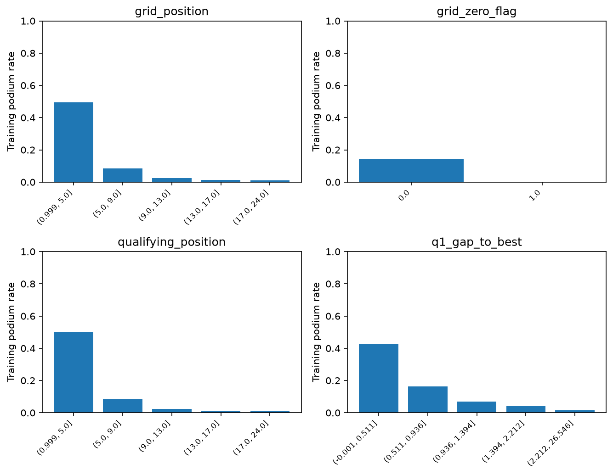

Training feature-evidence panel 1; candidate rationale and missingness are documented in feature_register.csv.

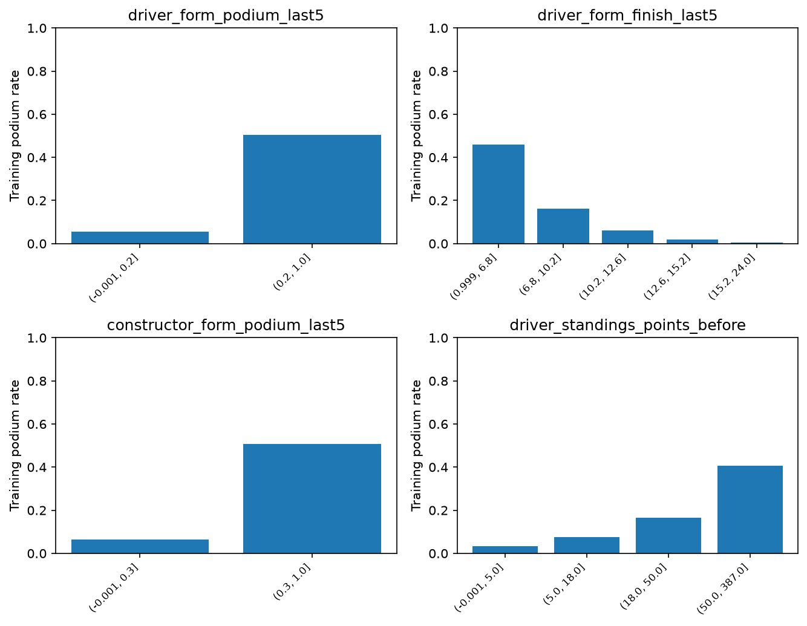

Training feature-evidence panel 2; candidate rationale and missingness are documented in feature_register.csv.

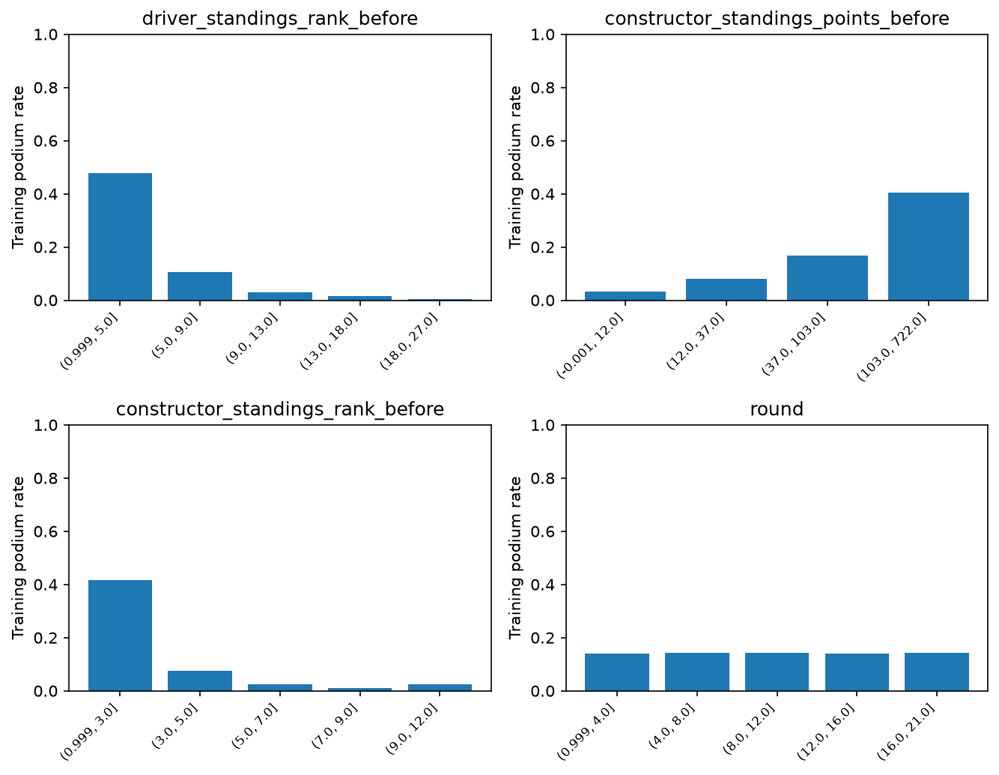

Training feature-evidence panel 3; candidate rationale and missingness are documented in feature_register.csv.

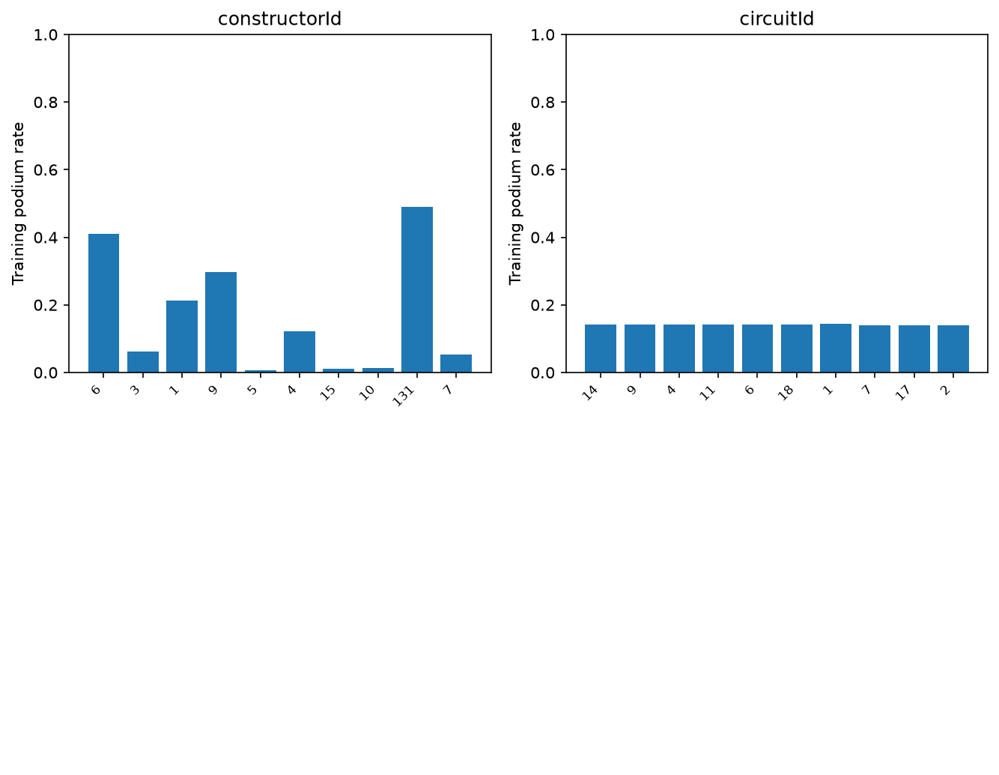

Training feature-evidence panel 4; candidate rationale and missingness are documented in feature_register.csv.

## Sources and methods references

- MS1 Description (Project).pdf, pp. 1-8: official supplied milestone requirements.

- Introduction for Formula 1 Beginners (Project).pdf, pp. 1-7: domain interpretation and historical cautions.

- [Assignment-cited Kaggle/Ergast dataset](https://www.kaggle.com/datasets/rohanrao/formula-1-world-championship-1950-2020), downloaded snapshot hashes in source_manifest.json.

- [scikit-learn leakage and preprocessing guidance](https://scikit-learn.org/stable/common_pitfalls.html).

- [scikit-learn MLPClassifier](https://scikit-learn.org/stable/modules/generated/sklearn.neural_network.MLPClassifier.html).

- [SHAP TreeExplainer](https://shap.readthedocs.io/en/latest/generated/shap.TreeExplainer.html) and [SHAP PermutationExplainer](https://shap.readthedocs.io/en/latest/generated/shap.PermutationExplainer.html).

- [LIME tabular explanation documentation](https://lime-ml.readthedocs.io/en/latest/lime.html).
